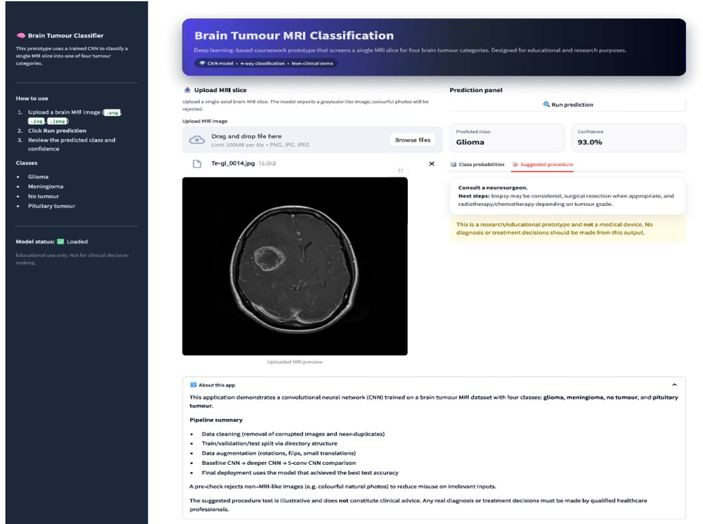

# Brain Tumour Classification (MRI) — Deep Learning (CNN)

A deep learning project that classifies brain MRI scans into **four classes**:

- **Glioma**
- **Meningioma**
- **Pituitary tumour**
- **No tumour**

Developed as an academic project (LSBU Deep Learning module), comparing multiple CNN architectures and deployed as a **Streamlit app** for real-time inference.



---

## Project Goals

Brain tumour diagnosis from MRI is time-consuming and can vary between clinicians.
This project builds a **CNN-based decision-support prototype** that predicts the tumour type from an input MRI image and displays predicted probabilities.

> **Important:** This is a research and educational prototype, **not** a clinically approved diagnostic tool.

---

## Dataset Summary

The dataset is organised into predefined splits (Train / Validation / Test) with class folders.

After duplicate handling, the dataset sizes are:

| Split | Images |
|------|--------|
| Train | 4,420 |
| Validation | 571 |
| Test | 576 |
| **Total** | **5,567** |

### Duplicate Handling

- A hash-based scan found duplicates grouped into **182 duplicate groups**.
- Duplicates were removed from **Train/Validation** (257 images removed).
- Duplicates in **Test** were kept to avoid severe class imbalance and maintain fair evaluation.

---

## Data Preparation

- Resize all images to **224 × 224**
- Normalise pixel values to **[0, 1]** by dividing by **255**
- Standardise channels (dataset included RGB, grayscale and rare RGBA)
- Apply **data augmentation** on training data: rotation, shifts, zoom, shear, horizontal flip

---

## Models

Three CNN models were developed and compared.

### Model 1 — Baseline CNN
- 3 Conv + MaxPool blocks
- Dense + Dropout
- Trained ~10 epochs

### Model 2 — Deeper CNN + Regularisation
- Convolutional blocks with L2 regularisation, BatchNorm and Dropout
- Callbacks: EarlyStopping, ReduceLROnPlateau, ModelCheckpoint
- Class weighting tested to improve meningioma performance

### Model 3 — Five-Layer CNN (Final)
- 5 Conv + MaxPool stages for deeper feature extraction
- Selected as final due to best overall performance and improved meningioma classification

---

## Results (Test Set)

| Model | Test Accuracy |
|------|--------|
| Baseline CNN | ~80% |
| Deeper CNN | ~82% |
| **Five-layer CNN (Final)** | **~87%** |

The final model substantially improved meningioma performance, reducing meningioma to "no tumour" misclassification compared with earlier models.

---

## Streamlit App

Workflow:

1. Load trained model
2. Upload an MRI image
3. Resize and normalise
4. Predict tumour class and probability distribution
5. Display predicted class, confidence and bar chart
6. Show an educational "clinical suggestion" panel (non-medical)

### Exception Handling

The app accepts **brain MRI-like grayscale inputs** and rejects unrelated coloured or natural images to reduce misleading predictions.

---

## How to Run Locally

### 1) Install dependencies

```bash
pip install -r requirements.txt
```

### 2) Run the Streamlit app

Make sure the following files are in the **same folder**:

- `brain_train_tumor_final_model.h5`
- `brain_tumor_detection.py`
- `class_labels.json`

Then open a terminal, navigate to that folder, and run:

```bash
streamlit run brain_tumor_detection.py
```
